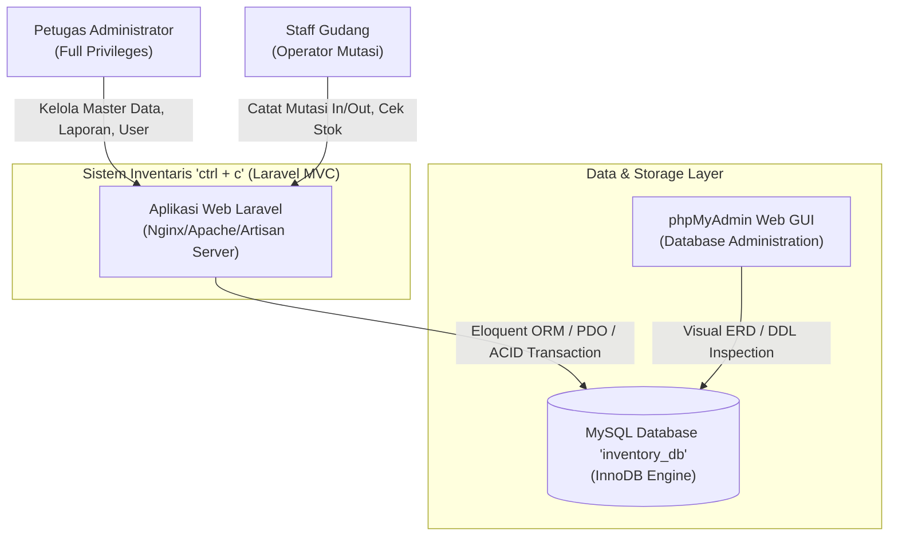
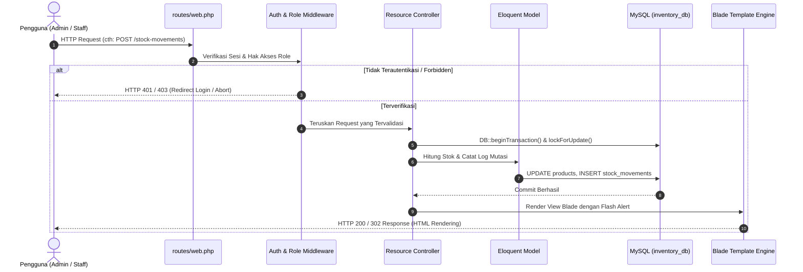
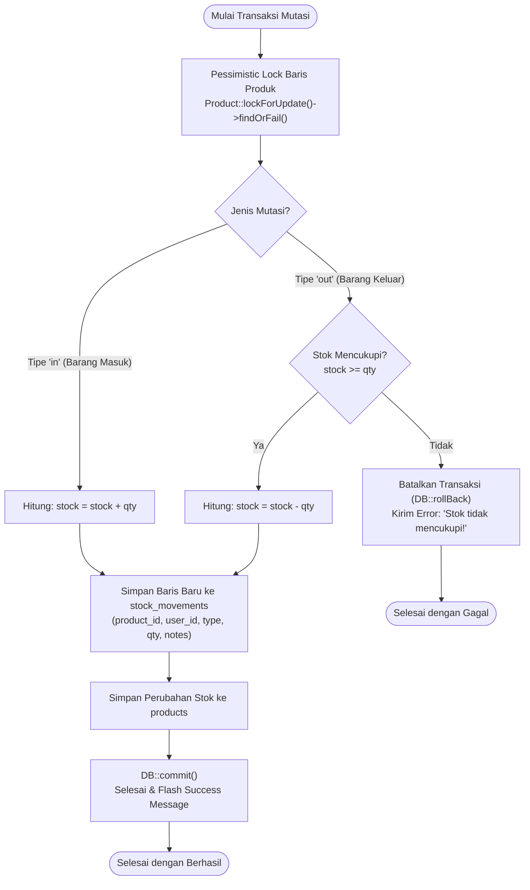

# Software Architecture Document (SAD) Blueprint
## Sistem Manajemen Inventaris ("ctrl + c")
### Berbasis Framework Laravel MVC & Database MySQL (phpMyAdmin)

---

## 1. Pendahuluan & Identifikasi Dokumen

| Metadata | Keterangan |
|---|---|
| **Nama Dokumen** | Software Architecture Document (SAD) Blueprint |
| **Nama Aplikasi** | Inventory Management System |
| **Nama Tema / UI** | `ctrl + c` (Modern Glassmorphism Design System) |
| **Framework** | Laravel 12 (PHP 8.4) |
| **Database Engine** | MySQL 8.x / MariaDB (InnoDB Engine via phpMyAdmin) |
| **Nama Database** | `inventory_db` |
| **Arsitektur Utama** | Model-View-Controller (MVC) + Service / Transaction Layer |
| **Versi Dokumen** | 2.0 (Migrasi P4 PHP Native ke P5 Laravel) |

---

## 2. Gambaran Umum & Tujuan Arsitektural

Aplikasi ini merupakan transformasi sistem manajemen inventaris dari model PHP Native prosedural (Pertemuan 4) menjadi arsitektur berbasis framework MVC modern (Pertemuan 5). 

### Karakteristik & Sasaran Arsitektur:
1. **Pemisahan Perhatian (Separation of Concerns)**: Memisahkan secara tegas lapisan Routing (`routes/web.php`), Pengontrol Alur Logika (`app/Http/Controllers`), Representasi Domain Data (`app/Models`), dan Antarmuka Pengguna (`resources/views`).
2. **Integritas Data Transaksional (ACID & Pessimistic Locking)**: Menjamin konsistensi stok fisik gudang agar tidak pernah bernilai negatif dalam kondisi *concurrency*.
3. **Role-Based Access Control (RBAC)**: Pembagian hak akses antara `admin` (kontrol penuh) dan `staff` (operasional pencatatan stok tanpa akses master user/pengaturan).
4. **Desain Modern Glassmorphism**: Tampilan visual semi-transparan dengan efek *frosted glass* (`backdrop-filter: blur`), palet warna modern, dan responsif lintas resolusi.

---

## 3. Arsitektur Tingkat Tinggi (High-Level Architecture)

### 3.1 Diagram Konteks Sistem (C4 Model - Level 1)



### 3.2 Diagram Kontainer & Alur Request-Response (C4 Model - Level 2)



---

## 4. Perancangan Basis Data & Entity Relationship Diagram (ERD)

Struktur tabel di bawah ini diekstraksi langsung dari skema resmi database **`inventory_db`** pada **phpMyAdmin**:

### 4.1 Diagram ERD Lengkap (Mermaid Syntax)

```mermaid
erDiagram
    %% Core Domain Tables & Relationships
    categories ||--o{ products : "memiliki (1:N)"
    users ||--o| user_profiles : "memiliki (1:1)"
    users ||--o{ stock_movements : "mencatat (1:N)"
    products ||--o{ stock_movements : "mencatat mutasi (1:N)"
    products ||--o{ product_supplier : "dihubungkan (1:N)"
    suppliers ||--o{ product_supplier : "menyuplai (1:N)"
    
    %% Framework System Tables
    users ||--o{ sessions : "memiliki sesi (1:N)"

    categories {
        bigint id PK "UNSIGNED, auto_increment"
        varchar name "NOT NULL"
        text description "NULL"
        timestamp created_at "NULL"
        timestamp updated_at "NULL"
    }

    products {
        bigint id PK "UNSIGNED, auto_increment"
        bigint category_id FK "UNSIGNED, NOT NULL"
        varchar name "NOT NULL"
        varchar sku "NOT NULL, UNIQUE"
        text description "NULL"
        decimal price "15,2, NOT NULL, DEFAULT 0.00"
        int stock "NOT NULL, DEFAULT 0"
        int min_stock "NOT NULL, DEFAULT 5"
        timestamp created_at "NULL"
        timestamp updated_at "NULL"
    }

    suppliers {
        bigint id PK "UNSIGNED, auto_increment"
        varchar name "NOT NULL"
        varchar email "NULL"
        varchar phone "NULL"
        text address "NULL"
        timestamp created_at "NULL"
        timestamp updated_at "NULL"
    }

    product_supplier {
        bigint id PK "UNSIGNED, auto_increment"
        bigint product_id FK "UNSIGNED, NOT NULL"
        bigint supplier_id FK "UNSIGNED, NOT NULL"
        decimal supplier_price "12,2, NULL"
        timestamp created_at "NULL"
        timestamp updated_at "NULL"
    }

    users {
        bigint id PK "UNSIGNED, auto_increment"
        varchar name "NOT NULL"
        varchar email "NOT NULL, UNIQUE"
        timestamp email_verified_at "NULL"
        varchar password "NOT NULL"
        varchar role "NOT NULL, DEFAULT 'staff'"
        varchar remember_token "100, NULL"
        timestamp created_at "NULL"
        timestamp updated_at "NULL"
    }

    user_profiles {
        bigint id PK "UNSIGNED, auto_increment"
        bigint user_id FK "UNSIGNED, NOT NULL, UNIQUE"
        varchar full_name "100, NOT NULL"
        varchar phone_number "30, NULL"
        varchar department "100, NULL"
        text bio "NULL"
        timestamp created_at "NULL"
        timestamp updated_at "NULL"
    }

    stock_movements {
        bigint id PK "UNSIGNED, auto_increment"
        bigint product_id FK "UNSIGNED, NOT NULL"
        bigint user_id FK "UNSIGNED, NOT NULL"
        enum type "'in', 'out', NOT NULL"
        int quantity "NOT NULL"
        text notes "NULL"
        timestamp created_at "NULL"
        timestamp updated_at "NULL"
    }

    sessions {
        varchar id PK "255, NOT NULL"
        bigint user_id FK "UNSIGNED, NULL"
        varchar ip_address "45, NULL"
        text user_agent "NULL"
        longtext payload "NOT NULL"
        int last_activity "NOT NULL"
    }

    cache {
        varchar key PK "255, NOT NULL"
        mediumtext value "NOT NULL"
        bigint expiration "NOT NULL"
    }

    cache_locks {
        varchar key PK "255, NOT NULL"
        varchar owner "255, NOT NULL"
        bigint expiration "NOT NULL"
    }

    jobs {
        bigint id PK "UNSIGNED, auto_increment"
        varchar queue "255, NOT NULL"
        longtext payload "NOT NULL"
        smallint attempts "UNSIGNED, NOT NULL"
        int reserved_at "UNSIGNED, NULL"
        int available_at "UNSIGNED, NOT NULL"
        int created_at "UNSIGNED, NOT NULL"
    }

    job_batches {
        varchar id PK "255, NOT NULL"
        varchar name "255, NOT NULL"
        int total_jobs "NOT NULL"
        int pending_jobs "NOT NULL"
        int failed_jobs "NOT NULL"
        longtext failed_job_ids "NOT NULL"
        mediumtext options "NULL"
        int cancelled_at "NULL"
        int created_at "NOT NULL"
        int finished_at "NULL"
    }

    failed_jobs {
        bigint id PK "UNSIGNED, auto_increment"
        varchar uuid "255, NOT NULL, UNIQUE"
        varchar connection "255, NOT NULL"
        varchar queue "255, NOT NULL"
        longtext payload "NOT NULL"
        longtext exception "NOT NULL"
        timestamp failed_at "NOT NULL"
    }

    password_reset_tokens {
        varchar email PK "255, NOT NULL"
        varchar token "255, NOT NULL"
        timestamp created_at "NULL"
    }

    migrations {
        int id PK "UNSIGNED, auto_increment"
        varchar migration "255, NOT NULL"
        int batch "NOT NULL"
    }
```



---

## 5. Kamus Data & Integritas Relasional (Data Dictionary)

### 5.1 Matriks Aturan Foreign Key (Referential Integrity)

| Relasi | Kolom Asal | Tabel Induk | On Delete | On Update | Rationale Arsitektur |
|---|---|---|:---:|:---:|---|
| **Kategori &rarr; Produk** | `products.category_id` | `categories.id` | **`RESTRICT`** | `RESTRICT` | Mencegah terhapusnya kategori yang masih memiliki produk aktif. |
| **Produk &rarr; Mutasi** | `stock_movements.product_id` | `products.id` | **`RESTRICT`** | `RESTRICT` | Produk dengan rekam jejak audit mutasi barang dilarang keras dihapus. |
| **User &rarr; Mutasi** | `stock_movements.user_id` | `users.id` | **`CASCADE`** | `RESTRICT` | Rekam jejak audit dipertahankan atau disinkronkan saat siklus user diperbarui. |
| **User &rarr; Profil** | `user_profiles.user_id` | `users.id` | **`CASCADE`** | `RESTRICT` | Relasi One-to-One: Jika user dihapus, data profil otomatis ikut terhapus. |
| **Pivot Produk-Supplier** | `product_supplier.product_id` | `products.id` | **`CASCADE`** | `RESTRICT` | Jika produk terhapus, asosiasi ke supplier di junction table terhapus. |
| **Pivot Produk-Supplier** | `product_supplier.supplier_id` | `suppliers.id` | **`CASCADE`** | `RESTRICT` | Jika supplier terhapus, pasangan pivot terkait otomatis dibersihkan. |

---

## 6. Pola Logika Bisnis & Transaksi ACID

### 6.1 Algoritma Pencatatan Mutasi Stok
Setiap penambahan barang masuk (`in`) atau pengurangan barang keluar (`out`) wajib melewati tahapan verifikasi transaksional berikut:



---

## 7. Desain Keamanan & Otorisasi (RBAC Blueprint)

### 7.1 Matriks Hak Akses (Role-Permission Matrix)

| Fitur / Modul | URL Endpoint | Administrator | Staff Gudang | Catatan Keamanan |
|---|---|:---:|:---:|---|
| **Dashboard** | `/dashboard` | Ya *(dengan Realtime Charts)* | Ya *(Tanpa Charts / Operasional)* | Staff hanya melihat ringkasan KPI dan aksi cepat. |
| **Katalog Produk** | `/products` | Akses Penuh (CRUD) | Baca Saja (Read-Only) | Staff tidak memiliki tombol Tambah/Ubah/Hapus. |
| **Stok Kritis** | `/products/low-stock` | Akses Penuh | Baca Saja | Memantau produk $\le$ batas minimum. |
| **Kategori** | `/categories` | Akses Penuh (CRUD) | Ditolak (403 Forbidden) | Hanya administrator. |
| **Supplier** | `/suppliers` | Akses Penuh (CRUD) | Ditolak (403 Forbidden) | Hanya administrator. |
| **Kelola Pengguna** | `/users` | Akses Penuh (CRUD) | Ditolak (403 Forbidden) | Dibatasi via middleware `role:admin`. |
| **Pencatatan Stok** | `/stock-movements/create` | Ya | Ya | Fitur inti bersama untuk mencatat in/out. |
| **Laporan & Analisis** | `/reports` | Akses Penuh | Ditolak (403 Forbidden) | Agregasi dan valuasi aset gudang. |

---

## 8. Desain Antarmuka Pengguna ("ctrl + c" Glassmorphism System)

1. **Efek Frosted Glass**:
   - `background: rgba(255, 255, 255, 0.78)`
   - `backdrop-filter: blur(16px)`
   - `border: 1px solid rgba(255, 255, 255, 0.7)`
   - `box-shadow: 0 10px 30px -5px rgba(15, 23, 42, 0.05)`
2. **Tipografi**:
   - Teks Utama: *Plus Jakarta Sans* (Humanist, bersih, mudah dibaca).
   - Identitas Brand & SKU: *JetBrains Mono* (Monospace teknis yang elegan).
3. **Pembersihan Simbol**:
   - Standar penomoran menggunakan **`No.`** (mengeliminasi tanda `#`).
   - Laporan naratif bisnis (mengeliminasi simbol kalkulasi `Σ`, `AVG`, `COUNT` mentah pada view user).

---

## 9. Topologi Deployment & Eksekusi

```
[Web Server: Nginx / Apache / Artisan Serve] (Port 8000)
                    │
                    ├──> [PHP 8.4 + Laravel 12 Engine]
                    │
                    └──> [MySQL Server (InnoDB Engine)] (Port 3306)
                                   ▲
                                   │
                      [phpMyAdmin GUI Interface] (Port 80)
```

Untuk memigrasi dan menjalankan arsitektur ini secara lengkap:
```bash
# Migrasi dan seeding database ke MySQL
php artisan migrate:fresh --seed

# Eksekusi testing otomatis untuk verifikasi kualitas arsitektur
php artisan test

# Menjalankan server lokal
php artisan serve
```
