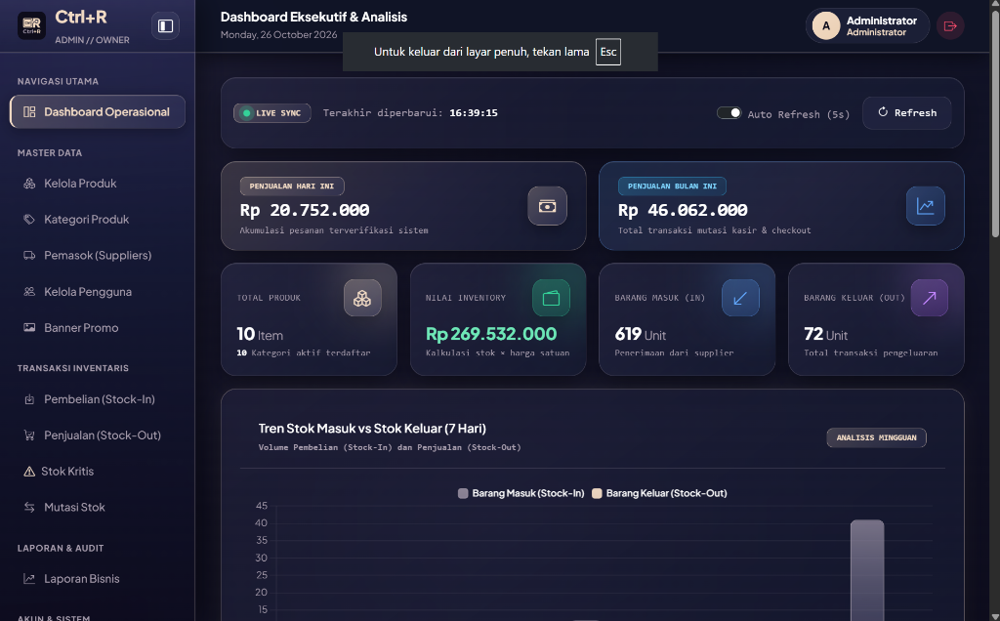
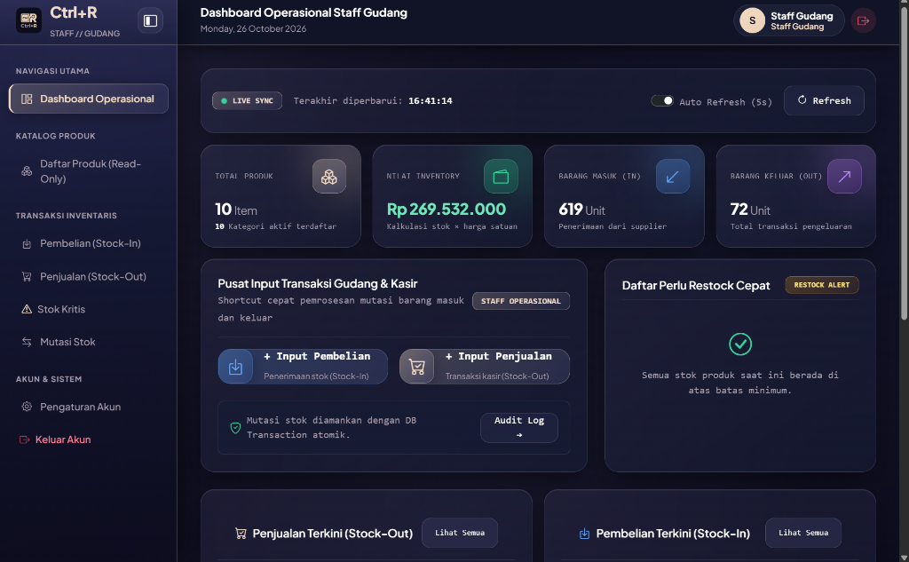
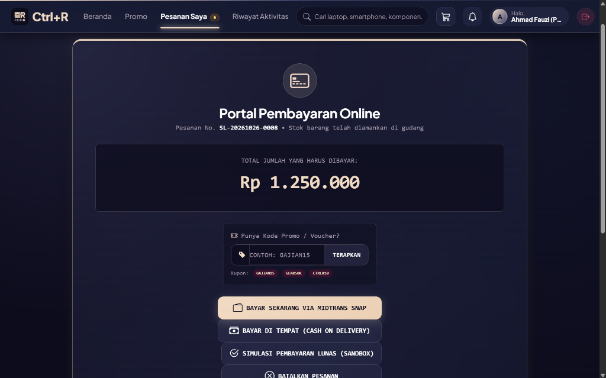
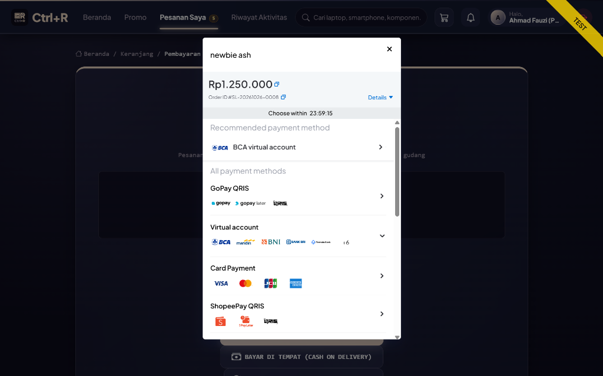
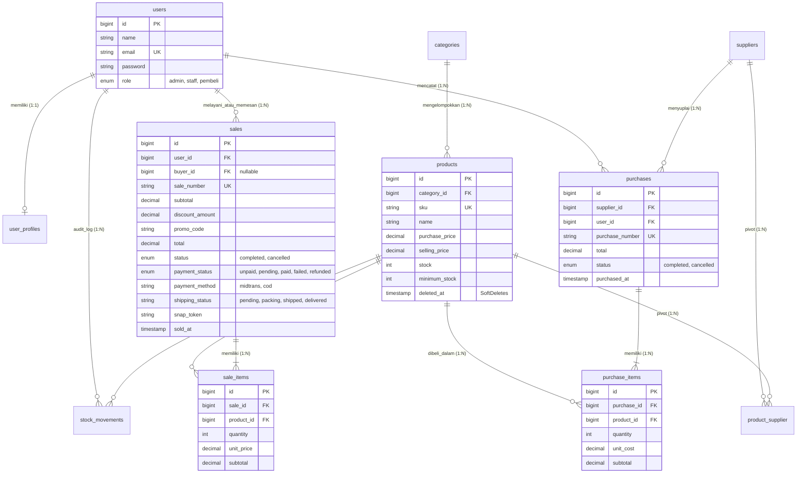

# Integrated Laravel Project: Inventory & Sales Management System
### Ujian Tengah Semester (UTS) Pemrograman Web 2

Aplikasi bisnis terintegrasi pengelolaan inventaris, pembelian stok (*Stock-In*), penjualan (*Stock-Out*), dan pembayaran online berbasis **Laravel 12 / PHP 8.4**, **MySQL**, **Eloquent ORM**, **Blade Views**, dan **Midtrans Snap Sandbox**.

---

## 1. Project Overview

Sistem ini dirancang untuk mengatasi permasalahan pencatatan manual pada usaha distribusi barang:
- **Konsistensi Stok**: Stok otomatis bertambah saat transaksi *Purchase (Stock-In)* berhasil dan berkurang saat transaksi *Sale (Stock-Out)* berhasil.
- **Pencegahan Overselling**: Pengecekan stok secara *atomic* dengan *pessimistic locking* (`lockForUpdate()`), memastikan produk yang habis tidak dapat dijual.
- **Audit Mutasi**: Setiap mutasi fisik dicatat ke tabel riwayat (*audit log*) beserta identitas pengguna dan cap waktu (*timestamp*).
- **Role-Based Access Control (RBAC)**: Pembatasan akses berbasis peran (*Admin/Owner*, *Staff Gudang/Kasir*, dan *Pembeli*).
- **Dashboard & Analisis**: Ringkasan eksekutif omzet penjualan, nilai aset inventaris, tren mutasi mingguan, dan peringatan stok kritis (*low-stock alert*).

---

## 2. System Requirements

- **PHP**: `>= 8.2` (ekstensi: `pdo_mysql`, `mbstring`, `openssl`, `tokenizer`, `xml`, `ctype`, `json`, `bcmath`, `curl`)
- **Composer**: `>= 2.2`
- **Database**: `MySQL 8.0+` atau `MariaDB 10.4+` (mendukung `SQLite` untuk *testing*)
- **Node.js & NPM**: `>= 18.x` (opsional untuk *build assets*)

---

## 3. Installation Step-by-Step

```bash
# 1. Kloning repositori project
git clone <repository-url>
cd "inventory system fikri"

# 2. Pasang dependensi backend PHP via Composer
composer install

# 3. (Opsional) Pasang dependensi frontend jika mengompilasi ulang aset
npm install
npm run build
```

---

## 4. Environment Setup

```bash
# 1. Salin template file konfigurasi environment
cp .env.example .env

# 2. Buat application encryption key
php artisan key:generate
```

Konfigurasikan koneksi basis data MySQL pada berkas `.env`:
```dotenv
DB_CONNECTION=mysql
DB_HOST=127.0.0.1
DB_PORT=3306
DB_DATABASE=inventory_db
DB_USERNAME=root
DB_PASSWORD=
```

*(Opsional) Konfigurasi kredensial sandbox Midtrans:*
```dotenv
MIDTRANS_SERVER_KEY=SB-Mid-server-xxxxxxxxxxxx
MIDTRANS_CLIENT_KEY=SB-Mid-client-xxxxxxxxxxxx
MIDTRANS_IS_PRODUCTION=false
```

---

## 5. Migration & Seeding

Jalankan perintah migrasi dan pengisian data contoh (*seeders*) untuk membuat seluruh skema tabel dan data master awal secara otomatis:

```bash
php artisan migrate:fresh --seed
```

Untuk menjalankan server pengembangan lokal:
```bash
php artisan serve
```
Aplikasi dapat dibuka melalui peramban web pada: **`http://127.0.0.1:8000`**

---

## 6. Demo Accounts (3 Role RBAC)

Sistem menerapkan **Server-Side Role-Based Access Control (RBAC)** ketat via [`RoleMiddleware`](app/Http/Middleware/RoleMiddleware.php). Seluruh akun demo telah dienkripsi dengan *Bcrypt hashing*:

| Role | Email | Password | Hak Akses Utama |
|---|---|---|---|
| **Admin / Owner** | `admin@example.com` | `password` | Akses penuh CRUD Kategori, Produk, Supplier, Manajemen Pengguna, Monitoring seluruh transaksi, Akses Dashboard & Laporan Bisnis, Pembatalan Transaksi (*Cancel Order*) dengan pemulihan stok otomatis. |
| **Staff Gudang / Kasir** | `staff@example.com` | `password` | Read-only katalog produk & monitoring stok kritis, membuat transaksi Pembelian (*Stock-In*) dari pemasok, melayani transaksi Penjualan (*Stock-Out*) kasir. Ditolak jika mengakses menu master data Admin. |
| **Pembeli (Buyer / Customer)** | `pembeli@example.com` | `password` | Melihat katalog barang tersedia (`stock > 0`), pencarian & filter, checkout langsung atau via keranjang, pembayaran via **Midtrans Snap** atau **COD (Bayar di Tempat)**, dan melacak status pesanan. |

*(Akun alternatif: `admin@inventory.com` dan `staff@inventory.com` dengan password `password`).*

---

## 7. Screenshots Halaman Utama & Transaksi

Berikut bukti tangkapan layar antarmuka sistem yang memenuhi persyaratan pengumpulan UTS:

### A. Dashboard Eksekutif Admin / Owner
Menampilkan ringkasan omzet hari ini dan bulan ini, total nilai valuasi inventaris gudang, total unit masuk/keluar, grafik tren mutasi mingguan, serta menu lengkap Master Data dan Laporan Bisnis.



---

### B. Dashboard Operasional Staff Gudang & Kasir
Menampilkan pintasan cepat *Input Pembelian (Stock-In)* dari supplier, *Input Penjualan (Stock-Out)* kasir, kartu *Audit Mutasi Stok*, dan daftar produk yang memerlukan *Restock* cepat tanpa akses ke data master sensitif.



---

### C. Portal Pembayaran & Aksi Transaksi Pesanan
Halaman rincian tagihan pesanan online pembeli dengan integrasi opsi *Bayar Sekarang via Midtrans Snap*, *Bayar di Tempat (COD)*, *Simulasi Pembayaran Lunas (Sandbox)*, form kupon promo (*GAJIAN15*, *GEAR50K*, *CTRLR10*), serta tombol *Batalkan Pesanan*.



---

### D. Integrasi Payment Gateway (Midtrans Snap Sandbox)
*Pop-up* interaktif Midtrans Snap yang mendukung berbagai kanal pembayaran instan: BCA Virtual Account, Mandiri, BNI, BRI, Permata, GoPay / QRIS, ShopeePay, dan Simulasi Kartu Kredit.



---

## 8. Core Features & Business Rules

### Modul Aplikasi yang Tersedia
1. **Autentikasi & Otorisasi**: Login, logout, proteksi rute server-side (`role:admin`, `role:admin,staff`, `role:pembeli`).
2. **Kategori Produk**: CRUD kategori dengan validasi keunikan nama.
3. **Master Produk**: SKU unik, kategori, harga beli (*cost_price*), harga jual (*selling_price*), stok, batas minimum stok, upload foto produk, dan proteksi *Soft Delete*.
4. **Pemasok (Suppliers)**: CRUD data pemasok beserta nomor kontak dan email.
5. **Pembelian (Purchases / Stock-In)**: Pemilihan pemasok, multi-item produk, kalkulasi subtotal/total di server, dan pertambahan stok otomatis.
6. **Penjualan (Sales / Stock-Out)**: Transaksi multi-item, validasi kecukupan stok, pengurangan stok otomatis, dan penolakan jika stok tidak mencukupi.
7. **Laporan & Pencarian**: Filter rentang tanggal transaksi, status pesanan, pencarian SKU/nama, dan paginasi yang mempertahankan *query string* (`withQueryString()`).

### Aturan Bisnis & Konsistensi Data
1. **Atomicity (`DB::transaction`)**:
   Penyimpanan data header transaksi, baris detail item, penyesuaian stok produk, dan pencatatan riwayat audit dibungkus dalam satu blok transaksi database. Jika salah satu baris gagal, seluruh operasi di-rollback tanpa ada data parsial yang tertinggal.
2. **Pencegahan Race Condition (`Product::lockForUpdate()`)**:
   Sebelum stok dicek atau dikurangi, baris data produk dikunci pada level database menggunakan *pessimistic locking* sehingga transaksi simultan tidak dapat menyebabkan *overselling*.
3. **Kalkulasi Harga di Sisi Server**:
   Harga satuan barang tidak mempercayai kiriman form peramban web (*browser*), melainkan diambil langsung dari kolom resmi tabel `products` di database.
4. **Pembatalan Transaksi Berintegritas**:
   Transaksi selesai tidak dapat diedit sembarangan. Pembatalan transaksi oleh Admin memulihkan stok secara presisi (mengurangi stok jika *Purchase* dibatalkan, menambah kembali stok jika *Sale* dibatalkan).
5. **Proteksi Soft Delete**:
   Produk yang sudah memiliki riwayat penjualan atau pembelian dilindungi dari *hard delete* melalui *trait* `SoftDeletes` dan validasi foreign key, sehingga riwayat audit tetap terjaga utuh.

---

## 9. Entity Relationship Diagram (ERD) & Relasi Eloquent



### Penjelasan Relasi Eloquent
- **`Category hasMany Product` & `Product belongsTo Category`**: Satu kategori dapat menaungi banyak produk. Kolom `category_id` berada di tabel `products` sebagai penunjuk kategori induk.
- **`Supplier hasMany Purchase` & `Purchase belongsTo Supplier`**: Pemasok dapat menyuplai banyak transaksi *Stock-In*.
- **`Purchase hasMany PurchaseItem` & `PurchaseItem belongsTo Purchase`**: Satu faktur pembelian memiliki rincian item barang beserta harga beli grosir dan jumlah kuantitas.
- **`Sale hasMany SaleItem` & `SaleItem belongsTo Sale`**: Satu nota penjualan menampung banyak item barang yang dibeli pelanggan.
- **Mengapa Foreign Key berada di tabel detail (`purchase_items`, `sale_items`)?**: Karena relasi berkardinalitas satu-ke-banyak (*1:N*). Sebuah transaksi memiliki banyak item barang, sehingga ID transaksi induk harus disimpan di setiap baris item anak untuk mencegah redundansi pada tabel induk.

---

## 10. Automated Feature Tests (86 Tests Passed)

Sistem dilengkapi rangkaian pengujian unit dan fitur otomatis (**PHPUnit / Laravel Testing Suite**) yang menguji integritas logika bisnis secara menyeluruh:

```bash
php artisan test
```

### Ringkasan Hasil Uji:
```text
PASS  Tests\Unit\ExampleTest
PASS  Tests\Feature\AuthTest
PASS  Tests\Feature\CustomerActivityAndOrdersTest
PASS  Tests\Feature\CustomerCartTest
PASS  Tests\Feature\CustomerSettingsTest
PASS  Tests\Feature\InventorySystemTest
PASS  Tests\Feature\ProductReviewTest
PASS  Tests\Feature\PromoBannerTest
PASS  Tests\Feature\PromoPageTest

Tests:    86 passed (385 assertions)
Duration: 4.82s
```

### Skenario Kritis yang Teruji:
1. **Autentikasi & Tamu**: Tamu (*guest*) dilarang membuka dashboard; kata sandi yang salah ditolak dengan pesan galat yang jelas.
2. **Validasi Master Data**: SKU yang duplikat ditolak di sisi server; harga beli/jual bernilai negatif ditolak.
3. **Pertambahan Stok (*Stock-In*)**: Transaksi pembelian berhasil menambah stok fisik produk sesuai kuantitas faktur.
4. **Pengurangan Stok (*Stock-Out*)**: Transaksi penjualan kasir dan pesanan online mengurangi stok fisik secara akurat.
5. **Penolakan Stok Kurang (*Insufficient Stock*)**: Percobaan menjual barang melebihi stok yang tersedia ditolak tanpa mengubah data inventaris.
6. **Atomisitas Multi-Item**: Jika terdapat 1 item yang gagal pada pembelian atau penjualan multi-item, seluruh transaksi otomatis di-rollback.
7. **Restorasi Stok saat Pembatalan**: Pembatalan nota transaksi penjualan oleh Admin mengembalikan stok ke gudang secara otomatis.
8. **Otorisasi Server-Side**: Akun Staff dan Pembeli ditolak dengan status HTTP 403 Forbidden ketika mencoba mengakses URL atau fungsi administratif Admin.

---

## 11. Known Limitations (Batasan Sistem)

Sesuai ruang lingkup slide panduan UTS, sistem ini memiliki batasan yang memang tidak diwajibkan:
1. **Multi-Warehouse Fisik Tunggal**: Pengelolaan stok diasumsikan berada pada satu gudang pusat distribusi utama.
2. **Payment Gateway Mode Sandbox**: Pembayaran online menggunakan kredensial lingkungan pengujian resmi Midtrans Sandbox tanpa memproses pemotongan saldo perbankan riil.
3. **Akuntansi Lanjutan**: Sistem mencatat laba kotor (*Gross Margin*) dan omzet penjualan, namun belum mencakup modul akuntansi pembukuan jurnal umum ganda (*Double-Entry Bookkeeping*) atau perhitungan depresiasi aset tetap.

---

## 12. Panduan Wawancara Kepemilikan Kode (*Code Ownership Interview*)

Sebagai persiapan sesi wawancara langsung bersama dosen penilai (Slide 24), berikut panduan teknis jawaban pertanyaan inti:

1. **Mengapa Sale memiliki relasi `hasMany` ke SaleItem?**
   - *Jawaban*: Sebuah transaksi penjualan dapat memuat lebih dari satu jenis produk dengan jumlah dan harga satuan masing-masing. Relasi `hasMany` merepresentasikan kardinalitas *1:N* dengan `sale_id` sebagai *foreign key* pada tabel `sale_items`.
2. **Di mana sistem memastikan stok tidak menjadi negatif?**
   - *Jawaban*: Pada [`SaleController.php` baris 108](app/Http/Controllers/SaleController.php#L108) dan [`OrderController.php` baris 139](app/Http/Controllers/Customer/OrderController.php#L139), sebelum `decrement`, sistem mengecek `if ($product->stock < $qty)` lalu melempar `ValidationException`.
3. **Mengapa total penjualan dihitung di server?**
   - *Jawaban*: Nilai harga dari *browser* mudah dimanipulasi melalui *Inspect Element*. Server mengambil harga resmi langsung dari database (`$product->selling_price`) dan menghitung `subtotal = price * qty` secara independen.
4. **Apa risiko jika pengurangan stok dilakukan di luar `DB::transaction`?**
   - *Jawaban*: Risiko inkonsistensi data (*partial update*). Jika item kedua gagal disimpan akibat kendala jaringan atau kesalahan database, stok item pertama sudah terlanjur berkurang tanpa ada rekam nota transaksi.
5. **Bagaimana mencegah Staff mengakses fungsi Admin melalui URL langsung?**
   - *Jawaban*: Menerapkan middleware server-side [`RoleMiddleware`](app/Http/Middleware/RoleMiddleware.php) (`role:admin`) pada grup rute di [`routes/web.php`](routes/web.php#L141). Jika Staff mengetik rute Admin secara manual, server langsung menolak dengan status HTTP 403 Forbidden.
6. **Apa yang terjadi jika dua penjualan memproses stok produk yang sama hampir bersamaan?**
   - *Jawaban*: Sistem memanfaatkan *Pessimistic Locking* `Product::lockForUpdate()->findOrFail($productId)`. Transaksi kedua harus menunggu transaksi pertama selesai (*commit*), sehingga kuantitas stok yang dibaca selalu merupakan kondisi terkini dan *overselling* dicegah.
7. **Tunjukkan validasi SKU unik dan jelaskan peran constraint database:**
   - *Jawaban*: Validasi `'sku' => ['required', 'unique:products,sku']` di [`ProductController.php`](app/Http/Controllers/ProductController.php) bertugas memberikan pesan galat yang ramah kepada pengguna, sedangkan `$table->string('sku')->unique()` pada berkas migrasi bertindak sebagai pertahanan tingkat basis data (*database-level integrity*).
8. **Ubah aturan minimum stock dan tunjukkan dampaknya:**
   - *Jawaban*: Kolom `min_stock` pada produk menentukan ambang batas aman. Ketika `stock <= min_stock`, produk tersebut secara otomatis masuk ke dalam daftar **Stok Kritis** (`/products/low-stock`) dan memicu lencana peringatan *Restock Alert* pada dashboard.
