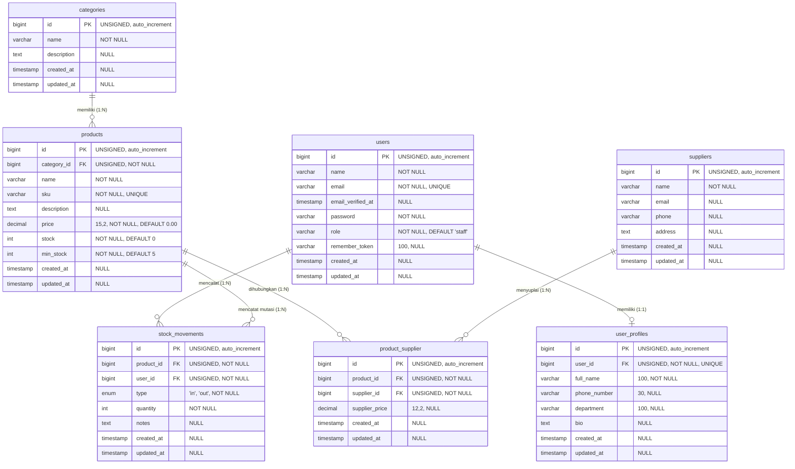

# Inventory Management System ("ctrl + c")
### Migrasi P4 (PHP Native) ke P5 (Laravel MVC) dengan Database MySQL / phpMyAdmin

Aplikasi Web **Inventory Management System** berdesain modern **Glassmorphism** dengan tema **`ctrl + c`**, yang dibangun berdasarkan modul materi perkuliahan:
- **Pertemuan 4 (P4)**: *Relational Database + Advanced PHP (Problem & Business Logic)*
- **Pertemuan 5 (P5)**: *Laravel Fundamental (Migrasi PHP Native ke Arsitektur MVC Laravel)*

Dokumen arsitektur perangkat lunak lengkap dapat dilihat di [**BLUEPRINT_SAD.md**](file:///c:/Users/fikri/OneDrive/Documents/program%20sejauh%20ini/inventory%20system%20fikri/BLUEPRINT_SAD.md).

---

## 1. Panduan Menjalankan Aplikasi

### Prasyarat
- PHP >= 8.2 (disarankan PHP 8.4)
- Composer >= 2.0
- Web Server & Database: **MySQL / MariaDB** (via XAMPP / Laragon / MySQL Service aktif pada port `3306`)
- Ekstensi PHP: `pdo_mysql`, `mbstring`, `openssl`

### Konfigurasi Database `.env` (MySQL / phpMyAdmin)
Pastikan berkas `.env` telah mengarah ke database MySQL:
```env
DB_CONNECTION=mysql
DB_HOST=127.0.0.1
DB_PORT=3306
DB_DATABASE=inventory_db
DB_USERNAME=root
DB_PASSWORD=
```

### Langkah Menjalankan:
```bash
# 1. Masuk ke direktori project
cd "inventory system fikri"

# 2. Pastikan database inventory_db sudah dibuat (atau jalankan script otomatis jika belum)
# MySQL query: CREATE DATABASE IF NOT EXISTS inventory_db;

# 3. Jalankan migrasi dan seeder data awal ke MySQL
php artisan migrate:fresh --seed

# 4. Jalankan unit & feature tests untuk verifikasi (17 test lulus)
php artisan test

# 5. Jalankan server lokal
php artisan serve
```

Aplikasi dapat langsung diakses di browser: **`http://127.0.0.1:8000`**  
phpMyAdmin dapat diakses di: **`http://localhost/phpmyadmin`** (Pilih database **`inventory_db`**)

### Akun Uji Coba Bawaan (Hasil Seeder):
| Role | Email | Password | Hak Akses |
|---|---|---|---|
| **Administrator** | `admin@inventory.com` | `password` | Akses penuh: Master data Kategori, Supplier, Produk, Pengguna, Transaksi Stok, Laporan Eksekutif, dan Grafik Interaktif Realtime. |
| **Staff Gudang** | `staff@inventory.com` | `password` | Hak operasional: Melihat katalog produk, mencatat transaksi barang masuk/keluar, dan dashboard operasional (tanpa grafik/chart). |

---

## 2. Entity Relationship Diagram (ERD)

Diagram di bawah ini sesuai dengan hasil ekspor skema tabel resmi dari database **`inventory_db`** di **phpMyAdmin**:



### Cara Melihat ERD Visual di phpMyAdmin:
1. Buka browser ke **`http://localhost/phpmyadmin`**.
2. Pilih database **`inventory_db`** di sisi kiri.
3. Klik menu **Desainer (Designer)** pada tab menu bagian atas (atau via **Lainnya / More** &rarr; **Desainer**).
4. phpMyAdmin akan menampilkan skema grafis relasi foreign key secara interaktif.

---

## 3. Matriks Relasi Database (Sesuai P4 & P5)

| Jenis Relasi | Tabel Terlibat | Keterangan & Implementasi |
|---|---|---|
| **One-to-One** | `users` &harr; `user_profiles` | Satu user memiliki tepat satu profil rinci (`user_profiles.user_id` bertipe `UNIQUE FK`). |
| **One-to-Many** | `categories` &rarr; `products` | Satu kategori memiliki banyak produk. Kolom `products.category_id` berstatus `RESTRICT` saat delete. |
| **One-to-Many** | `products` &rarr; `stock_movements` | Satu produk memiliki banyak riwayat transaksi mutasi. |
| **One-to-Many** | `users` &rarr; `stock_movements` | Satu user/petugas mencatat banyak transaksi mutasi. |
| **Many-to-Many** | `products` &harr; `suppliers` | Satu produk dapat disuplai banyak supplier dan sebaliknya, melalui tabel pivot `product_supplier` yang memiliki atribut pivot `supplier_price`. |

---

## 4. Fitur Utama & Desain Antarmuka

### Desain "ctrl + c" Modern Glassmorphism
- **Frosted Glass Styling**: Kartu dan panel menggunakan `backdrop-filter: blur(16px)` dengan transparansi halus, border lembut, serta bayangan melayang (*ambient soft shadow*).
- **Tipografi Profesional**: Menggunakan kombinasi font modern *Plus Jakarta Sans* untuk keterbacaan tinggi dan *JetBrains Mono* untuk kode SKU serta identitas monospace.
- **Pembersihan Simbol**: Mengeliminasi simbol `#` pada seluruh tabel menjadi **`No.`**, menghilangkan formula teknis mentah (`Σ COUNT`, `Σ SUM`) dari halaman laporan.

### Pemisahan Tampilan Berdasarkan Peran (RBAC)
- **Administrator**: Memiliki akses penuh ke master data (Produk, Kategori, Supplier, Pengguna), laporan analisis valuasi aset, serta 3 grafik visual realtime Chart.js.
- **Staff Gudang**: Tampilan operasional tanpa grafik/chart (hanya melihat kartu ringkasan KPI, katalog produk, dan form pencatatan barang masuk/keluar).

---

## 5. Aturan Bisnis & Integritas Data (Business Rules)

1. **Stok Tidak Boleh Negatif**:
   - Saat transaksi pengeluaran (Barang Keluar / `out`), sistem memvalidasi `quantity <= stock`. Jika kuantitas melebihi stok yang tersedia, transaksi otomatis dibatalkan (`DB::rollBack()`).
2. **ACID Database Transaction & Pessimistic Locking**:
   - Menggunakan `DB::beginTransaction()` bersama `Product::lockForUpdate()` untuk mencegah kondisi *race condition* saat dua transaksi memproses produk yang sama secara bersamaan.
3. **Cegah Penghapusan Sembarangan (Referential Integrity RESTRICT)**:
   - Produk yang sudah memiliki histori transaksi pada `stock_movements` tidak dapat dihapus (dijamin oleh foreign key `RESTRICT` pada MySQL).
4. **Whitelist Sorting & Prepared Search**:
   - Pengurutan data dibatasi hanya pada kolom terdaftar (`name`, `price`, `stock`, `created_at`) dengan `withQueryString()` pada pagination.

---

## 6. Berkas Dokumen Terkait

- [**BLUEPRINT_SAD.md**](file:///c:/Users/fikri/OneDrive/Documents/program%20sejauh%20ini/inventory%20system%20fikri/BLUEPRINT_SAD.md): Dokumen Cetak Biru Arsitektur Perangkat Lunak (Software Architecture Document).
- [**database/schema.sql**](file:///c:/Users/fikri/OneDrive/Documents/program%20sejauh%20ini/inventory%20system%20fikri/database/schema.sql): Skrip DDL MySQL siap pakai untuk ekspor/impor database `inventory_db`.
