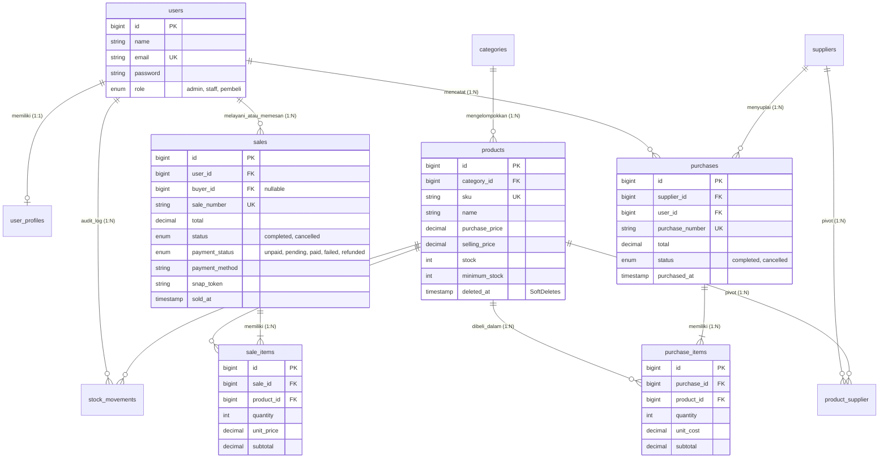

# Integrated Laravel Project: Inventory & Sales Management System
### Ujian Tengah Semester (UTS) Pemrograman Web 2

Aplikasi bisnis terintegrasi pengelolaan inventaris, pembelian stok (*Stock-In*), penjualan (*Stock-Out*), dan pembayaran online berbasis **Laravel 12 / PHP 8.4**, **MySQL**, **Eloquent ORM**, **Blade Views**, dan **Midtrans Snap Sandbox**.

---

## 1. Akun Demo Uji Coba (3 Role)

Sistem menerapkan **Server-Side Role-Based Access Control (RBAC)** ketat via `RoleMiddleware`.

| Role | Email | Password | Hak Akses Utama |
|---|---|---|---|
| **Admin / Owner** | `admin@example.com` | `password` | Full CRUD Master Data (Kategori, Produk, Supplier), Manajemen User, Melihat seluruh transaksi, Akses Dashboard & Laporan, serta Membatalkan Transaksi (*Cancel Order* & pemulihan stok otomatis). |
| **Staff Gudang / Kasir** | `staff@example.com` | `password` | Read-only katalog produk & monitoring stok kritis, membuat transaksi Purchases (Stock-In) dari supplier, dan melayani transaksi Sales (Stock-Out) kasir. |
| **Pembeli (Buyer / Customer)** | `pembeli@example.com` | `password` | Melihat katalog elektronik tersedia (`stock > 0`), filter kategori & pencarian, checkout multi-item via **Midtrans Snap**, dan melihat riwayat pesanan miliknya sendiri. |

*(Tersedia pula akun legacy: `admin@inventory.com` dan `staff@inventory.com` dengan password `password`).*

---

## 2. Panduan Instalasi & Menjalankan Aplikasi

Aplikasi dapat dijalankan secara reproducible pada *clean environment* sesuai petunjuk slide UTS:

```bash
# 1. Masuk ke direktori project
cd "inventory system fikri"

# 2. Install dependensi PHP
composer install

# 3. Siapkan file environment jika belum ada
cp .env.example .env
php artisan key:generate

# 4. Konfigurasi kredensial database di .env (MySQL)
# DB_CONNECTION=mysql
# DB_HOST=127.0.0.1
# DB_PORT=3306
# DB_DATABASE=inventory_db
# DB_USERNAME=root
# DB_PASSWORD=

# 5. Jalankan migrasi dan seeder
php artisan migrate:fresh --seed

# 6. Jalankan automated test suite (26 Feature Tests)
php artisan test

# 7. Jalankan server lokal
php artisan serve
```

Aplikasi dapat diakses pada: **`http://127.0.0.1:8000`**

---

## 3. Entity Relationship Diagram (ERD)



---

## 4. Aturan Bisnis & Konsistensi Stok (Business Logic)

1. **Atomicity (`DB::transaction`)**:
   Penyimpanan header transaksi (`purchases`/`sales`), detail baris item (`purchase_items`/`sale_items`), mutasi stok produk (`increment`/`decrement`), dan pencatatan audit log (`stock_movements`) dibungkus dalam satu transaksi database atomik. Jika salah satu item gagal validasi, seluruh transaksi di-rollback tanpa sisa data separuh tersimpan.
2. **Pessimistic Locking (`lockForUpdate()`)**:
   Mencegah *race condition* dan *overselling* saat banyak staf kasir atau pembeli memesan produk yang sama bersamaan. Setiap produk dikunci menggunakan `Product::lockForUpdate()->findOrFail($productId)` sebelum pengecekan stok dilakukan.
3. **Validasi Server-Side Ketat**:
   - Total harga tidak pernah mempercayai input browser. Harga satuan diambil langsung dari record produk resmi di database (`selling_price` / `purchase_price`), kemudian dihitung murni di server (`subtotal = price * qty`).
   - Jika kuantitas pesanan melebihi stok yang tersisa, transaksi seketika dibatalkan dan melempar `ValidationException` informatif.
4. **Pembatalan Transaksi & Pemulihan Stok (Admin Only)**:
   Transaksi yang telah selesai dilarang diedit sembarangan. Admin dapat membatalkan transaksi yang secara otomatis mengembalikan stok ke kondisi semula (mengurangi stok jika membatalkan *Purchase*, menambah stok jika membatalkan *Sale*).
5. **Integritas Master Data & Soft Delete**:
   Produk yang sudah terikat pada riwayat transaksi tidak dapat di-*hard delete* (dilindungi aturan relasi FK dan Eloquent `SoftDeletes`).

---

## 5. Integrasi Payment Gateway Midtrans Snap

- **Mode**: Sandbox (`app.sandbox.midtrans.com`).
- **Alur Kerja**:
  1. Pembeli melakukan checkout pesanan multi-item pada katalog produk.
  2. Sistem secara atomik mengamankan stok produk di database dan membuat `snap_token` melalui `MidtransService`.
  3. Pembeli membuka popup pembayaran Midtrans Snap (mendukung QRIS, GoPay, BCA/Mandiri/BNI Virtual Account, dan simulasi kartu kredit sandbox).
  4. Webhook notification otomatis memproses verifikasi *signature key* `sha512` di `/payments/midtrans-notification` dan memperbarui status pembayaran. Jika pembayaran gagal/dibatalkan/expired, sistem secara otomatis mengembalikan stok barang ke inventaris.
  5. Tersedia tombol **Simulasi Bayar Lunas (Sandbox Demo)** pada invoice pesanan untuk kemudahan pengujian tanpa internet/webhook publik.

---

## 6. Bukti Pengujian Otomatis (Automated Feature Tests)

Seluruh skenario pengujian wajib lulus pengujian **PHPUnit**:

```bash
php artisan test
```

Hasil pengujian: **26 Tests Passed (101 Assertions, 0 Failures)**:
- `test_guest_is_redirected_to_login`: Tamu tidak dapat membuka dashboard tanpa autentikasi.
- `test_validation_rules`: SKU duplikat dan harga/kuantitas negatif ditolak oleh validasi server.
- `test_purchase_transaction_increases_stock_and_creates_items`: Pembelian menambah stok fisik secara akurat.
- `test_sale_transaction_decreases_stock_and_creates_items`: Penjualan kasir mengurangi stok sesuai kuantitas.
- `test_sale_insufficient_stock_is_rejected_and_data_unchanged`: Penjualan melebihi stok ditolak tanpa mengubah data inventaris.
- `test_sale_multi_item_atomicity_rolls_back_if_one_item_fails`: Jika 1 item gagal dalam multi-item, seluruh transaksi di-rollback.
- `test_admin_can_cancel_sale_and_stock_is_restored`: Admin membatalkan transaksi dan stok pulih kembali.
- `test_staff_and_pembeli_cannot_cancel_transactions`: Staff dan Pembeli ditolak (403) saat mencoba membatalkan transaksi.
- `test_pembeli_cannot_access_admin_or_staff_routes`: Pembeli ditolak (403) jika mengakses rute internal admin/staff via direct URL.
- `test_pembeli_can_browse_catalog_and_checkout_with_snap_token`: Pembeli dapat checkout dan token Snap Midtrans ter-generate.
- `test_pembeli_cannot_view_other_buyers_orders`: Pembeli dilarang melihat detail pesanan milik akun pembeli lain.
